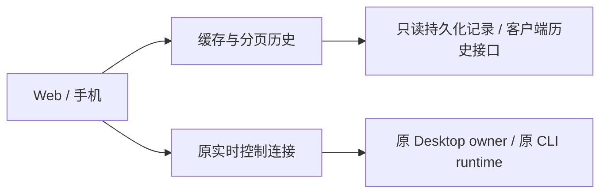

# 历史展示与实时控制拆分（2026-10-23）

状态：本地分支 `perf/history-control-decoupling`，基于原生分页只读原型 `0a27fdf`。
源码实现阶段未部署；后续 Test 构建与安装验收见文末。全部改动仍在本地，未推送。

## 行为与权限边界

进入会话后，缓存和最近历史先显示；更早内容由用户翻页时读取。历史读取不以
Desktop 完整快照到达为前提。原 owner 仍负责发送、停止、审批及实时补丁。
历史没有控制权限，过期的请求和历史 turn 状态不能作为当前操作依据。

- `LiveSession.history_state` 保存历史，`state` 保留原实时快照和 revision 补丁基底。
- 后台读取缓存与连接 owner 分离；快速历史优先，慢历史最多使 owner 起步延迟 100 ms。
- 首次展示只转换当前窗口中的消息正文；向前翻页扩大窗口。工具调用与结果跨页时保持关联，
  携带的旧调用不会使后续实时更新自动扩大到整段历史。
- 缓存不提供待审批请求。控制请求仍即时核验原 runtime，不进入只读请求合并或重试队列。
- 断开后，文件与图片的展示、授权使用同一份当前历史证据；认证、配对、路径边界不变。
- Claude/DSH 旧页只合并消息和文件引用，不覆盖当前状态、权限、审批、模型或草稿。
  切换会话、账号或接入后，迟到的分页响应作废。

## 各接入的历史来源

| 接入 | 本轮读取方式 | 保留的限制 |
| --- | --- | --- |
| Codex Desktop | 可兼容的 `thread_history_1.sqlite` 只读索引，按条目窗口查询；否则读取当前 rollout 尾部的完整 turn | 内部索引结构、进度与当前文件不匹配，或工具结果缺少对应调用时回退；这不是原 Desktop IPC 分页 RPC |
| Codex CLI | 复用同一持久化历史读取和展示窗口；原 daemon 仍负责实时控制 | 不用历史缓存伪造 CLI 已连接；控制侧仍可能取得较大状态 |
| Claude Code Desktop | 能力支持时使用原 `getTranscriptTail/getTranscriptPage` | 旧连接脚本或 Cowork 沿用完整 transcript；需更新连接脚本后才有新能力 |
| Claude Code CLI | 本机及 SSH 的 JSONL 反向分页；游标限定会话、文件版本和记录边界 | 单页扫描上限 4 MiB；文件变化使旧游标失效，显式重新读取最近页 |
| DSH | 原生记录分页，固定 `throughSeq`、使用 `beforeSeq` 读取更早页 | 截断页不能从最后一个历史 turn 推断当前状态 |

CLI 的历史、元信息和控制状态并非完全相同。Claude CLI 冷读取及日志变化后仍需扫描元信息，
以保留 cwd、权限、模型和上下文语义；SSH 列表后台刷新仍会扫描日志。未宣称所有冷路径都已
固定成本。分散在不同页的任务工具记录可能缺少前页任务上下文；原始消息仍可向前翻阅。

## A/B 只读实测

在本机现有 Desktop、原始会话和账号下测量。完整会话 ID、原始计时和哈希仅保留在本机
`.tmp/history-control-decoupling-20261023/`；不提交聊天内容或账号材料。

下表为最终补测的一次采样，不含公网、蜂窝网络或手机渲染时间；B 会话在本轮工作中持续增长。

| 指标 | A | B |
| --- | ---: | ---: |
| 最近历史读取 | 6.8 ms | 450.7 ms |
| 首屏消息数 | 20 | 20 |
| 首屏 JSON | 10,011 B | 10,247 B |
| 向前读取耗时 | 7.3 ms | 1,443.7 ms |
| 本次更早页消息数 | 100 | 65 |
| 更早页 JSON | 45,489 B | 31,499 B |
| 原翻页游标保留 | 是 | 是 |
| 历史成为控制状态 / 带回审批 | 否 | 否 |

A 使用原生持久化索引。B 的索引进度与当前 rollout 不一致，主动回退到当前文件尾部，
避免展示旧索引。B 的尾部完整 turn 读取仍会随 turn 大小变化。

另一次原 owner 只读订阅测量：A 初始帧 1,520,151 B、约 25 ms；B 初始帧
94,648,887 B、约 2.31 s。大快照到达后的首屏正文转换约 0.7 / 1.6 ms。
**本轮降低了历史首屏对大快照的依赖，没有消除 Desktop → 网关的首次全量传输。**

## 轻量通道的独立结果

原 owner 的 `thread-follower-read-model-settings` 可以在未订阅历史前读取：A/B 均约
404 B，耗时约 1.7 / 0.6 ms。仅确认模型设置元信息可独立读取，不能把它当成完整的运行状态、
审批或断线恢复通道。没有用它宣告“实时控制已连接”。

`scripts/prototypes/native_history.py settings --thread <id> --ipc <原 IPC 路径>
--output <项目 .tmp 下的结果路径>` 可单独复验，不 follow、不启动原生读取进程、不输出设置内容。
首次原生快照与补丁仍保持一致的 revision，不能丢弃快照后直接套用位置补丁。

## 验收范围

- Python 完整源码回归执行 2186 项，无失败，44 项按平台/原生环境跳过；追加的原型测试 11 项通过。覆盖缓存/实时状态隔离、跨页工具调用、旧索引回退、文件访问、原 CLI 控制、
  模拟 Windows/Linux 分支和无本地项目包的 SSH worker。
- Node 完整回归 892 项通过、1 项跳过；覆盖 Claude/DSH 原生分页、当前状态保护、历史消息与文件合并、迟到响应及缓存。
- 真实 Chromium 在 1366 px 和 390 px 下各执行 11 项历史交互断言：首屏、翻页、滚动位置、
  草稿、旧页文件引用和只读请求均通过。
- 本机真实 A/B owner、账号、cwd/provider/source 元信息、正式 App 文件、正式与 Test 配置、
  认证身份及现有手机会话均通过前后哈希或集合核验；没有发送消息或调用模型。
- 源码实现阶段未在 Windows/Linux 真机部署新包，未做 Android/iOS 原生 App 实机验收；这些不能由
  共享源码或 Chromium 窄屏通过替代。Claude Desktop Linux 原有能力边界保持不变。

相关入口：`tests/test_history_control_separation.py`、`tests/test_claude_cli_history.py`、
`tests/test_desktop_paged_turn_state.py`、`tests/desktop-sessions-ui.test.cjs` 和
`tests/browser/desktop-history.browser.js`。前一轮只读 API 能力证据见
[原生分页原型](native-history-prototype.md)。

## Test 安装验收（2026-10-24）

三平台 Test 使用产品提交 `b299ac4`，版本号仍为 `2.1.4-preview.1`。
后续提交仅修正测试夹具的资源释放顺序及文件系统时钟时序，没有改变打包产品代码。

| 平台 | 构建与安装 | 启动与只读回归 |
| --- | --- | --- |
| macOS arm64 | 独立 Test 覆盖更新，签名与资源哈希通过 | 8788 与 Test 窗口运行，包内模块 42 项通过；原 A/B 最近页及旧页读取通过 |
| Windows x64 | NSIS 仅更新 F 盘 Test，706 个安装文件核对通过 | 普通桌面用户窗口、网关健康检查、包内模块 42 项及静态资源缓存校验通过 |
| Ubuntu amd64 | DEB 仅重装 Test，716 个安装文件核对通过 | 图形桌面窗口、8788 网关、包内模块 42 项及静态资源缓存校验通过 |

Windows 实机回归补齐了 Claude JSONL 文件版本判断：使用原生文件 ChangeTime，避免将
创建时间当成内容变更时间，导致等长改写并还原修改时间后继续复用旧游标或元信息。
该读取只查询文件元数据，不增加完整日志扫描。SSH 的独立 worker 仍按目标 Unix 系统读取。

安装后的 Mac 本机 HTTP 采样：A/B 最近 20 条分别约 11.6/11.0 KB；向前读取 100 条分别
约 47.0/49.3 KB。最近页请求约 13–35 ms，旧页约 7–16 ms；这是当前缓存状态下的本机
接口测量，不代表冷缓存、公网、蜂窝网络或手机渲染耗时。旧页与当前页无重复键，游标 epoch
保持一致。首次 Desktop 全量快照仍存在，边界与前述说明相同。

三平台均核对正式版、原配置、账号文件和手机绑定保留；Mac 的 14 个有效登录绑定及 A/B
原始会话元信息不变。没有发送会话消息、审批或调用模型；手机端 A/B 上手复测由用户完成。
Windows 临时文件和构建产物均位于 F 盘；安装成功后删除旧 Test 安装包及重复中间产物，
保留当前安装版本、最新 Windows/Ubuntu 安装包和脱敏验收记录。

本机记录：`.tmp/history-control-verified-20261023/`；其中构建清单固定源提交、安装包哈希、
Test 隔离覆盖项及测试夹具修订，未包含在 Git 提交中。
